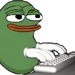

# YT 7TV Client



A browser extension that brings **7TV** emotes to **YouTube live chat**, using the emote set of a **Twitch** channel you pick. Tab completion works just like in the official 7TV extension.

[Português](README.pt-BR.md)

> Unofficial. Not affiliated with 7TV, YouTube or Twitch.

## Install

Not in the Chrome Web Store or Firefox Add-ons yet. For now it installs in developer mode only: see [INSTALL.md](INSTALL.md).

## Features

- **Asks on the first visit.** The first time you open a channel's live stream, a small dialog in the chat asks which Twitch channel to take the emotes from (e.g. `https://www.twitch.tv/cereaw`).
  - Any of these work: `https://www.twitch.tv/cereaw`, `www.twitch.tv/cereaw`, `twitch.tv/cereaw`, `@cereaw` or just `cereaw`.
  - The extension checks on 7TV that the channel exists and has an active emote set before saving it.
  - If the streamer linked their YouTube channel on 7TV, the dialog already suggests their Twitch channel.
  - **Not now** turns the extension off for that channel and it won't ask again (you can turn it back on in the settings).
- **Emotes in chat.** Emote names in messages become images, including *zero-width* emotes (hats, effects) stacked on the previous emote. Hovering shows the name, type and author.
- **7TV tab in the emoji picker.** YouTube's emoji button opens straight into a tab with the 7TV logo, holding the channel's emote set and the global emotes.
  - Clicking an emote types its name in the chat, followed by a space.
  - It has a search box, and YouTube's own tabs are still there.
  - The gear opens the current channel's settings without leaving the chat.
- **7TV-style Tab completion.**
  - `TA` + **Tab** completes the first emote starting with "ta" and adds a space.
  - **Tab** again goes to the next match, **Shift+Tab** goes back. The **←/→** arrows also move through the carousel.
  - Order: emotes before usernames, then by where the text appears in the name, then alphabetically. Up to 25 matches.
  - `@name` + Tab completes the names of people who talked in the chat. Text starting with `:` keeps YouTube's own emoji autocomplete.
- **Live updates.** When the streamer adds, removes or renames an emote (or switches the active set) mid-stream, the change shows up **without reloading**, through the 7TV EventAPI. Emotes show up right away from a saved copy of the set, and 7TV updates them a moment later. If 7TV is down, the saved copy keeps working and the extension retries on its own.
- **YouTube's limits.**
  - YouTube doesn't allow messages over 200 characters. The extension warns you and doesn't let Tab or the emote menu go past it.
  - When YouTube doesn't confirm a message you sent (it shows your message right away, before it knows it was accepted), a small note appears under it.
  - The chat switches to **Live chat** on its own. The default view, "Top chat", hides what YouTube considers spam, and emote-only messages get caught by it a lot.
- **Looks like YouTube.** Uses YouTube's font (Roboto) and colors, and follows YouTube's light or dark theme.
- **10 languages.** English, Portuguese, Spanish, French, Russian, Chinese (Mandarin, simplified), Hindi, Bengali, Arabic and Indonesian. It follows the browser's language, and you can pick another one in the settings.
- **Settings** (extension icon, or the gear in the 7TV tab): change the Twitch channel for the current stream, edit or remove saved channels, and turn each feature on or off.
- **Safe updates.** Settings and saved channels are kept across updates, and chats that were already open keep working with the new version without reloading the page.

**Good to know:** emotes are plain text in the message. People with the extension see the images, as long as they picked **the same Twitch channel** for that YouTube channel. Everyone else sees the names, just like on Twitch for people who don't use 7TV.

## Privacy

The extension has no analytics, no tracking and no servers of its own. Everything is stored in your browser. See the [privacy policy](PRIVACY.md).

## Building

Only Node.js is needed (no dependencies):

```bash
node scripts/build.mjs
```

This writes to `dist/`:

- `yt-7tv-client-<version>-chromium.zip` for the Chrome Web Store, Edge Add-ons or a manual install;
- `yt-7tv-client-<version>-firefox.zip` for addons.mozilla.org.

The Chromium package uses a background service worker and the Firefox one a background page; `build.mjs` adjusts the manifest for each.

To load it without building: on Chromium, **Load unpacked** the `extension/` folder; on Firefox, open `about:debugging#/runtime/this-firefox` and load `extension/manifest.json` as a temporary add-on.

To regenerate the icons from `assets/icon-source.png` (needs ImageMagick): `node scripts/make-icons.mjs`.

### Releasing

1. Bump the version in `extension/manifest.json`. Stores only accept a higher number than the last one.
2. Push a tag with the same number: `git tag v1.3.0 && git push origin v1.3.0`. The `release.yml` workflow builds both zips and creates a GitHub release with them.
3. Upload the Chromium zip to the Chrome Web Store and the Firefox zip to addons.mozilla.org.

## Project layout

```
extension/
  manifest.json            Manifest V3 (one file for Chromium and Firefox)
  background.js            migrates saved data on update; on Chromium, re-attaches open chats
  _locales/                extension name and description in 10 languages
  fonts/                   Roboto (Apache 2.0) for the popup
  icons/                   generated from assets/icon-source.png
  lib/core.js              namespace, lifecycle (safe hand-over between versions), DOM helpers, icons
  lib/i18n.js              translations and language detection
  lib/ui.js                YouTube-style colors and components, light/dark theme
  lib/storage.js           settings, YouTube → Twitch links, saved emote sets, migrations
  lib/seventv.js           7TV API (REST v3, GQL v4) and EventAPI client (WebSocket)
  lib/settings-ui.js       settings screen shared by the popup and the in-chat panel
  content/youtube.js       finds the video and channel behind the chat
  content/input.js         chat input (character count, inserting emotes)
  content/render.js        turns names into emotes in messages, tooltip
  content/tabcomplete.js   Tab completion and carousel (adapted from 7TV)
  content/guard.js         YouTube limits, unconfirmed messages, "Live chat"
  content/modal.js         base dialog used by the prompt and the settings
  content/prompt.js        first-visit dialog
  content/panel.js         settings inside the chat
  content/picker.js        7TV tab in the emoji picker
  content/main.js          ties everything together inside the chat iframe
  popup/                   settings screen (popup and options page)
scripts/                   build and icon generation
.github/workflows/         automatic release on tag push
```

**Services used:**

- `7tv.io` for emote sets and to look up Twitch IDs;
- `events.7tv.io` for live updates;
- `api.ivr.fi` as a fallback to look up Twitch IDs if the 7TV search fails;
- the YouTube video page itself, to find out which channel it belongs to.

## License

[Apache License 2.0](LICENSE), with these exceptions (details in [NOTICE](NOTICE)):

- `extension/content/tabcomplete.js` is adapted from the [7TV extension](https://github.com/SevenTV/Extension), which is Apache 2.0 with the Commons Clause, so that file **may not be sold**.
- The icon is a still frame of the 7TV emote [Chatting](https://7tv.app/emotes/01FBZESCNR000A6AWCB1X558GZ). The artwork belongs to its creators.
- Roboto is Apache 2.0, by Google.
