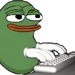

# YT 7TV Client



Extensão de navegador que traz os emotes da **7TV** para o **chat ao vivo do YouTube**, puxando o set de emotes de um canal da **Twitch** à sua escolha. O Tab-completion funciona igual ao da extensão oficial da 7TV.

[English](README.md)

> Extensão não oficial, sem vínculo com a 7TV, o YouTube ou a Twitch.

## Instalação

Ainda não está na Chrome Web Store nem nos Complementos do Firefox. Por enquanto, só instala no modo de desenvolvedor: veja o [INSTALL.pt-BR.md](INSTALL.pt-BR.md).

## O que ela faz

- **Pergunta na primeira visita.** Na primeira vez que você abre a live de um canal, aparece uma janelinha no chat perguntando de qual canal da Twitch puxar os emotes (ex.: `https://www.twitch.tv/cereaw`).
  - Vale qualquer um destes formatos: `https://www.twitch.tv/cereaw`, `www.twitch.tv/cereaw`, `twitch.tv/cereaw`, `@cereaw` ou só `cereaw`.
  - A extensão confere na 7TV se o canal existe e tem um set de emotes ativo antes de salvar.
  - Se o streamer vinculou o canal do YouTube na conta da 7TV, a janela já sugere o canal da Twitch dele.
  - **Agora não** desativa a extensão naquele canal e ela não pergunta de novo (dá para ativar depois nas configurações).
- **Emotes no chat.** Os nomes de emotes nas mensagens viram imagens, inclusive emotes *zero-width* (chapéus, efeitos) empilhados sobre o emote anterior. Passando o mouse aparece o nome, o tipo e o autor.
- **Aba da 7TV nos emojis.** O botão de emoji do YouTube abre direto numa aba com o logo da 7TV, com os emotes do set do canal e os globais.
  - Clicar num emote digita o nome no chat com um espaço depois.
  - Tem busca, e as abas do próprio YouTube continuam lá.
  - A engrenagem abre as configurações do canal atual sem sair do chat.
- **Tab-completion igual à 7TV.**
  - `TA` + **Tab** completa com o primeiro emote que começa com "ta" e coloca um espaço depois.
  - **Tab** de novo vai para o próximo resultado, **Shift+Tab** volta. As setas **←/→** também navegam no carrossel.
  - Ordem: emotes antes de nomes; depois pela posição do texto no nome; depois em ordem alfabética. Até 25 resultados.
  - `@nome` + Tab completa nomes de quem falou no chat. O texto que começa com `:` fica com o autocomplete de emojis do próprio YouTube.
- **Atualização em tempo real.** Quando o streamer adiciona, remove ou renomeia um emote (ou troca o set ativo) no meio da live, a mudança aparece **sem recarregar a página**, via EventAPI da 7TV. Os emotes aparecem na hora a partir de uma cópia salva do set e são atualizados em seguida pela 7TV. Se a 7TV estiver fora do ar, a cópia salva continua funcionando e a extensão tenta de novo sozinha.
- **Limites do YouTube.**
  - O YouTube não deixa mandar mais de 200 caracteres. A extensão avisa e não deixa o Tab nem o menu passarem disso.
  - Quando o YouTube não confirma uma mensagem enviada (ele mostra a sua mensagem na hora, antes de saber se foi aceita), aparece um aviso pequeno embaixo dela.
  - O chat muda sozinho para **Chat ao vivo**. A visão padrão, "Principais mensagens", esconde o que o YouTube considera spam, e mensagens só com emotes caem muito nisso.
- **Visual do YouTube.** Usa a fonte (Roboto) e as cores do YouTube, e segue o tema claro ou escuro do YouTube.
- **10 idiomas.** Português, inglês, espanhol, francês, russo, chinês (mandarim, simplificado), hindi, bengali, árabe e indonésio. Segue o idioma do navegador, e dá para escolher outro nas configurações.
- **Configurações** (ícone da extensão, ou a engrenagem na aba da 7TV): trocar o canal da Twitch da live atual, editar ou remover canais salvos e ligar ou desligar cada recurso.
- **Atualizações seguras.** As configurações e os canais salvos são mantidos nas atualizações, e os chats que já estavam abertos continuam funcionando com a versão nova sem recarregar a página.

**Importante:** os emotes são texto comum na mensagem. Quem tem a extensão vê as imagens, desde que tenha escolhido **o mesmo canal da Twitch** para aquele canal do YouTube. Quem não tem a extensão vê só os nomes, como acontece na Twitch para quem não usa a 7TV.

## Privacidade

A extensão não tem análise de uso, rastreamento nem servidor próprio. Tudo fica salvo no seu navegador. Veja a [política de privacidade](PRIVACY.md).

## Gerar os pacotes

Precisa só do Node.js (sem dependências):

```bash
node scripts/build.mjs
```

O comando gera em `dist/`:

- `yt-7tv-client-<versão>-chromium.zip`: para a Chrome Web Store, o Edge Add-ons ou a instalação manual;
- `yt-7tv-client-<versão>-firefox.zip`: para o addons.mozilla.org.

O pacote do Chromium usa um *service worker* em segundo plano e o do Firefox uma página de fundo; o `build.mjs` ajusta o manifest de cada um.

Para carregar sem gerar os pacotes: no Chromium, use **Carregar sem compactação** na pasta `extension/`; no Firefox, abra `about:debugging#/runtime/this-firefox` e carregue o `extension/manifest.json` como extensão temporária.

Para regerar os ícones a partir do `assets/icon-source.png` (precisa do ImageMagick): `node scripts/make-icons.mjs`.

### Publicar uma versão nova

1. Suba a versão em `extension/manifest.json`. As lojas só aceitam um número maior que o anterior.
2. Envie uma tag com o mesmo número: `git tag v1.3.0 && git push origin v1.3.0`. O workflow `release.yml` gera os dois zips e cria uma Release no GitHub com eles.
3. Envie o zip do Chromium para a Chrome Web Store e o do Firefox para o addons.mozilla.org.

A estrutura dos arquivos e os serviços usados estão descritos no [README em inglês](README.md#project-layout).

## Licença

[Apache License 2.0](LICENSE), com estas exceções (detalhes no [NOTICE](NOTICE)):

- `extension/content/tabcomplete.js` é adaptado da [extensão da 7TV](https://github.com/SevenTV/Extension), que é Apache 2.0 com a Commons Clause; por isso, esse arquivo **não pode ser vendido**.
- O ícone é um quadro parado do emote [Chatting](https://7tv.app/emotes/01FBZESCNR000A6AWCB1X558GZ) da 7TV. A arte pertence aos seus criadores.
- A fonte Roboto é Apache 2.0, do Google.
